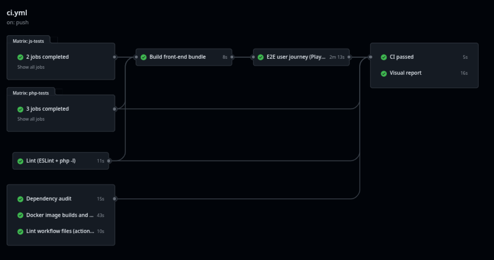
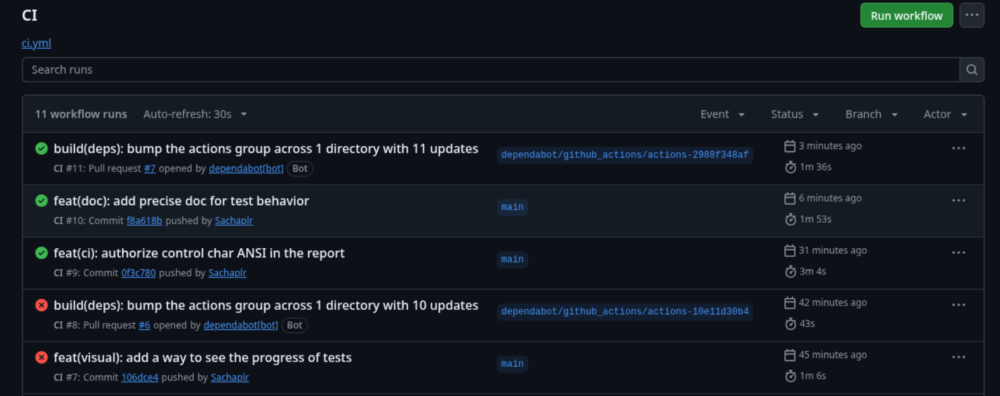
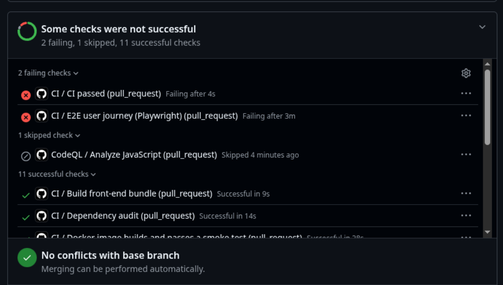
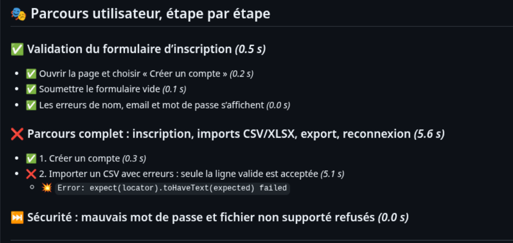
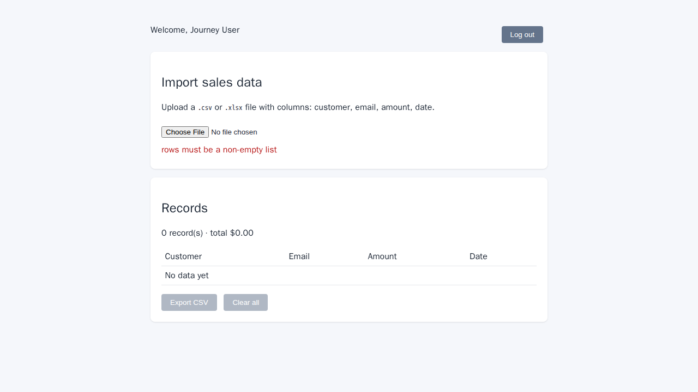

# À quoi servent les pipelines ? Démonstration en 2 parties

À chaque modification du code, GitHub rejoue automatiquement tous les tests. Si un bug s'est glissé, **la page Actions devient rouge et indique exactement quoi corriger** ; une fois corrigé, un nouveau passage la remet au vert, sans que personne n'ait à tester à la main.

| Partie | Histoire |
|---|---|
| **A — Un incident réel** | Une erreur de lint fait échouer la CI. Elle est corrigée, la CI repasse au vert. |
| **B — Un bug dans le navigateur** | Un bug que les tests unitaires ne voient pas, attrapé uniquement par le test dans un vrai navigateur. |

> Tout se consulte dans l'onglet **Actions** de GitHub : cliquer sur le titre d'un run ouvre sa page **Summary**, avec le graphe des jobs en haut, le rapport « 🚦 Résultat du pipeline » en dessous et les artefacts tout en bas.

---

# Partie A — L'incident réel : lint rouge, puis vert

Deux runs de la CI sur `main` racontent l'histoire :

| Run | Commit | Résultat |
|---|---|---|
| **CI #7** | feat(visual): add a way to see the progress of tests | ❌ le lint échoue |
| **CI #9** | feat(ci): authorize control char ANSI in the report | ✅ tout est vert |

## 1. Avant : tout est vert (référence)

Le graphe des jobs de la CI, quand tout va bien : lint, tests JS et PHP, build, parcours navigateur, audit, Docker et rapport sont tous en ✅.



Le rapport visuel confirme : 38/38 tests JS, 19/19 tests PHP, 3/3 parcours navigateur.


## 2. L'incident : le lint échoue

Une modification introduit une erreur de lint. **Une seule étape est en échec**, et la suite est automatiquement arrêtée : le build et le test navigateur sont grisés (⊘, « 0s ») puisqu'ils dépendent du lint. Rien n'est livré tant que ce n'est pas réglé.


Le rapport indique **quelle étape** est en cause, sans ouvrir un seul log : « ❌ 1 étape(s) en échec : Lint », avec la case Lint en rouge.


## 3. Lire l'erreur

Le log du job Lint donne **le fichier, la ligne, la colonne et la règle** :

```
/home/runner/work/mockup-CI-CD/mockup-CI-CD/scripts/ci-summary.mjs
  42:50  error  Unexpected control character(s) in regular expression: \x1b  no-control-regex
✖ 1 problem (1 error, 0 warnings)
```


Il n'y a rien à chercher : la règle `no-control-regex` interdit un caractère de contrôle dans une expression régulière, ici celui des codes couleur du terminal, utilisé volontairement.

## 4. Corriger et relancer

Le correctif tient en une ligne dans [`scripts/ci-summary.mjs`](../scripts/ci-summary.mjs) :

```diff
+// eslint-disable-next-line no-control-regex
 const stripAnsi = (s) => String(s ?? '').replace(/\u001b\[[0-9;]*m/g, '');
```

Un simple `git push` relance **automatiquement** toute la CI. L'historique raconte l'histoire tout seul : CI #7 ❌, puis CI #9 ✅ et CI #10 ✅.



---

# Partie B — Un bug que les tests unitaires ne voient pas

C'est le cas le plus parlant : lint ✅, tests JS ✅, tests PHP ✅, build ✅… et pourtant l'application est cassée. **Seul le test dans un vrai navigateur le détecte.**

## 1. Introduire le bug

Dans un terminal, à la racine du projet :

```bash
git checkout main && git pull
git checkout -b demo-bug
git apply docs/demo/bug-2-e2e.patch
git commit -am "perf: alléger l'import"
git push -u origin demo-bug
```

Le patch change **une seule ligne** de [`web/src/app.js`](../web/src/app.js) : la dernière ligne du fichier importé est oubliée.

```diff
-    const res = await api.importRows(state.pending.valid);
+    const res = await api.importRows(state.pending.valid.slice(0, -1));
```

Sur GitHub, un bandeau « **demo-bug had recent pushes** » propose d'ouvrir une Pull Request : **Compare & pull request**, puis **Create pull request**. La CI démarre (environ 4 minutes).

## 2. Tout passe, sauf le navigateur

Lint, tests unitaires, build, audit et Docker sont ✅. Seul **« E2E user journey (Playwright) »** est en ❌.


Dans la Pull Request, le panneau des vérifications montre la même chose : **E2E user journey ❌**, **CI passed ❌** et les autres vérifications ✅ (CodeQL y apparaît ⊘ sur cette capture, prise avant son passage en mode autonome).



> **Pourquoi deux échecs pour un seul bug ?** Il n'y a qu'**un seul vrai problème** :
> - **E2E user journey ❌** est la **cause** : le bug.
> - **CI passed ❌** est la **conséquence** : ce job-récapitulatif échoue dès qu'un job requis échoue. Il offre **une seule vérification à surveiller**, et son log liste les jobs (`OK lint`, `ECHEC e2e`…).
>
> Règle de lecture : on traite toujours le job rouge **le plus en amont** ; les autres suivent.

## 3. Trouver l'étape exacte qui casse

Le rapport rejoue le parcours utilisateur **étape par étape**. L'import d'un CSV est la première étape en échec ; les suivantes ne sont pas jouées (⏭️).

> ❌ **Parcours complet : inscription, imports CSV/XLSX, export, reconnexion**
> - ✅ 1. Créer un compte
> - ❌ **2. Importer un CSV avec erreurs : seule la ligne valide est acceptée**
>   - 💥 `Error: expect(locator).toHaveText(expected) failed`



Le même rapport est posté **automatiquement en commentaire de la Pull Request** : le relecteur voit le problème sans quitter la PR.


## 4. Voir ce que l'utilisateur aurait vu

Les preuves sont conservées dans les **artefacts** du run, même quand le test échoue : rapport HTML interactif, traces et **vidéo du parcours** (`playwright-report`), rapports de tests (`report-js`, `report-php`, `report-e2e`) et bundle construit (`app-bundle`).


Playwright prend aussi une capture d'écran au moment de l'échec. Ici, le fichier contenait une ligne valide, mais l'écran affiche **« rows must be a non-empty list »** et **0 enregistrement** : on *voit* le bug comme l'utilisateur l'aurait vu.



## 5. Corriger et relancer

On annule uniquement la ligne cassée, à l'aide du patch inverse :

```bash
git apply -R docs/demo/bug-2-e2e.patch
git commit -am "fix: restaurer l'import de toutes les lignes valides"
git push
```

> ⚠️ Éviter `git revert HEAD` : il annule le **dernier commit de la branche**, qui n'est pas forcément celui du bug (par exemple un commit de documentation).

Le push relance **automatiquement** tous les tests sur la même Pull Request. Cette fois, tout est vert, y compris le parcours navigateur et le job « CI passed ».


> Le bouton **Re-run all jobs** (en haut à droite d'un run) rejoue les mêmes tests sur le **même** code. Il sert après un incident passager (réseau, GitHub). Pour un vrai bug, il faut **corriger le code puis pousser**, comme ci-dessus.

---

## Ce que la démo prouve

| Sans pipeline | Avec pipeline |
|---|---|
| Le bug est découvert par un utilisateur, ou par hasard | Il est découvert **en quelques minutes**, avant la livraison |
| « Ça marche chez moi » | Les tests tournent dans un environnement **neutre, identique à chaque fois** |
| Il faut tester à la main tout le parcours | Le parcours complet est rejoué **automatiquement**, navigateur compris |
| On cherche où est le problème | Le rapport indique **l'étape, le fichier, la ligne et le message** |
| Corriger puis espérer | On corrige, on pousse, on **voit** le retour au vert |

Les deux parties sont complémentaires : le **lint et les tests unitaires** sont rapides et précis (quelle ligne, quelle fonction) ; le **test navigateur** attrape ce qu'ils ne voient pas, ici un bug d'assemblage entre l'écran et le serveur.

## Remettre le dépôt à zéro

```bash
git checkout main
git branch -D demo-bug
git push origin --delete demo-bug
```

## Remarque sur ce dépôt (privé)

Sur un dépôt privé en plan gratuit, GitHub n'empêche pas de fusionner une Pull Request rouge (« Merging can be performed automatically ») : le pipeline **informe** mais ne **bloque** pas. La démonstration reste identique ; seule la règle « interdit de fusionner si rouge » dépend du plan (voir le [README](../README.md#limites-dun-dépôt-privé-en-plan-gratuit-cas-de-ce-dépôt)). CodeQL fonctionne en mode autonome pour la même raison : le *code scanning* n'est pas activé sur ce dépôt, donc ses alertes s'affichent sur la page Summary du run plutôt que dans l'onglet Security.
