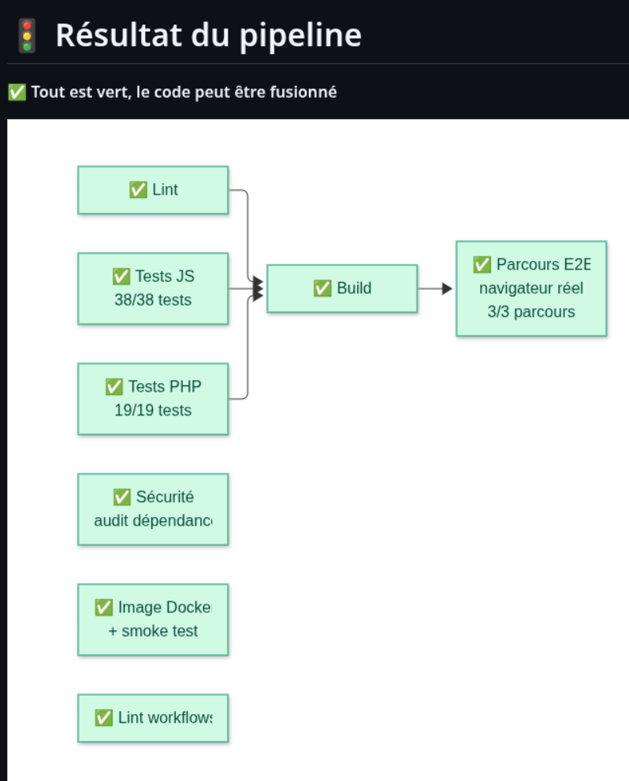
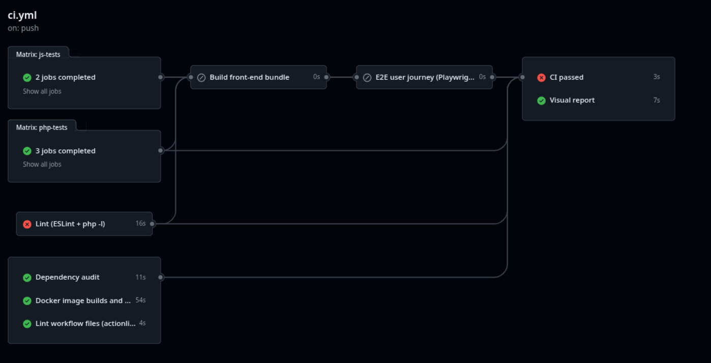
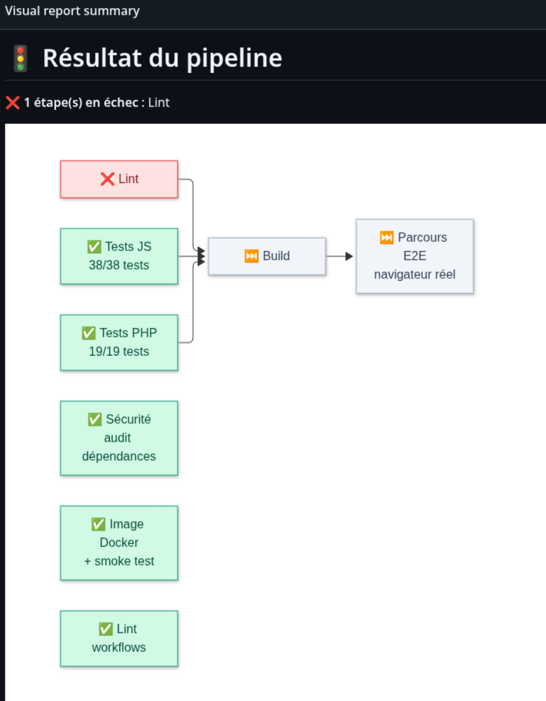
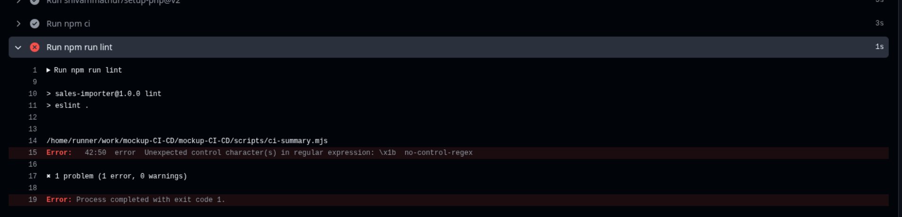
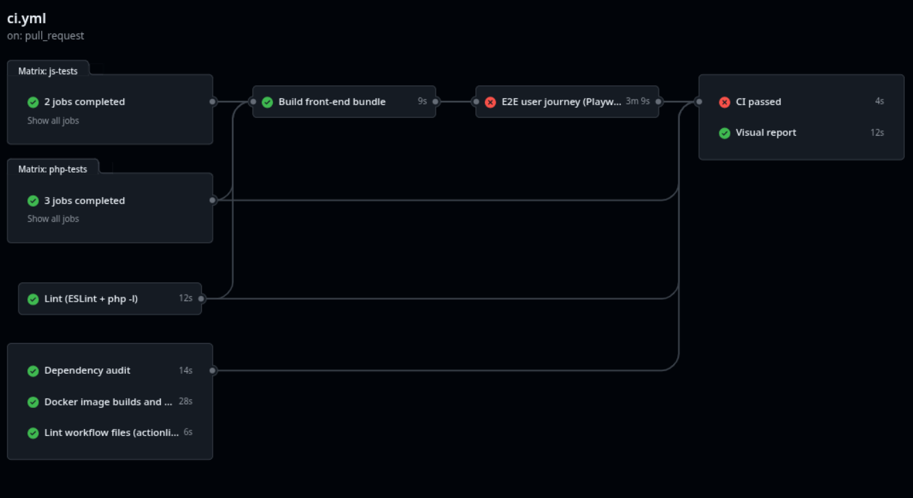
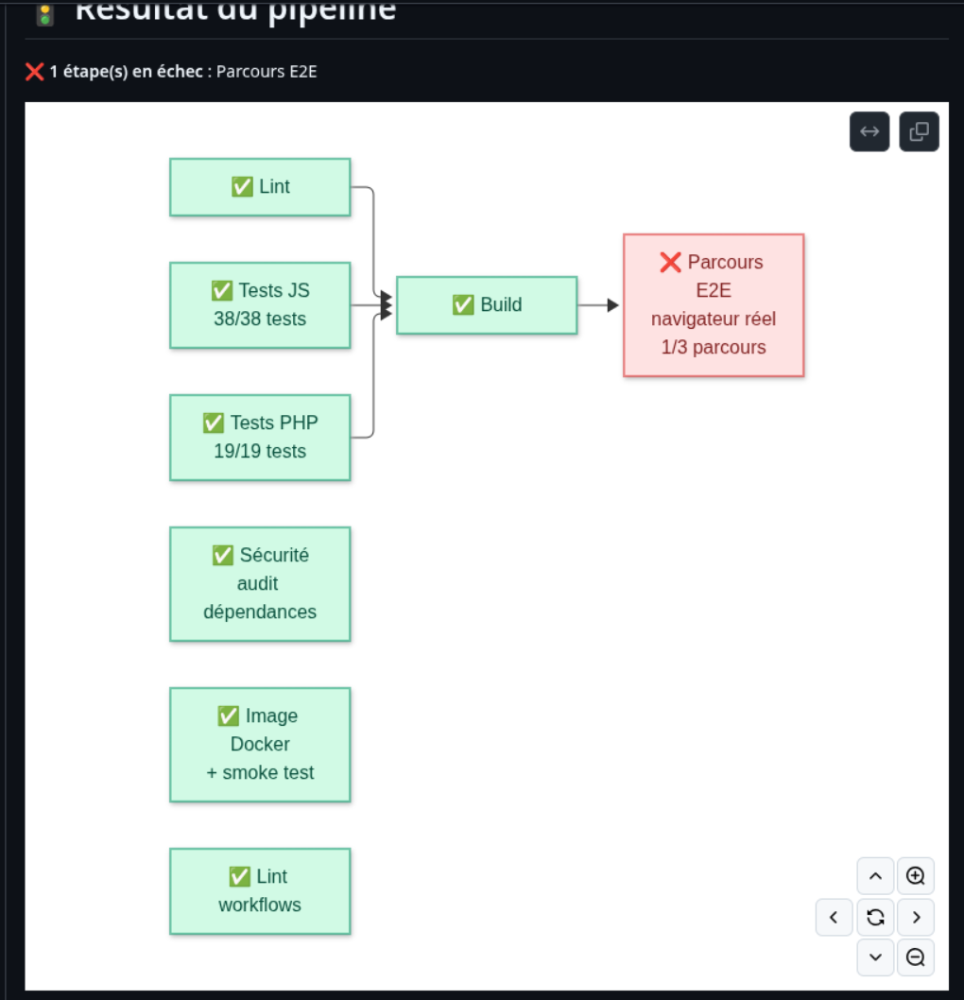
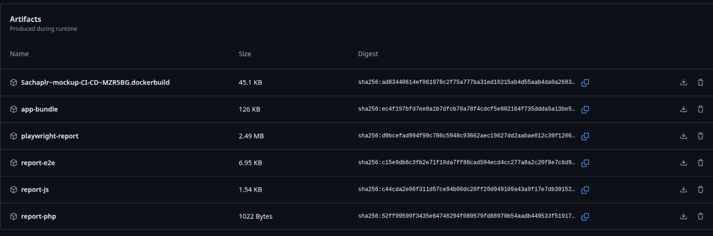
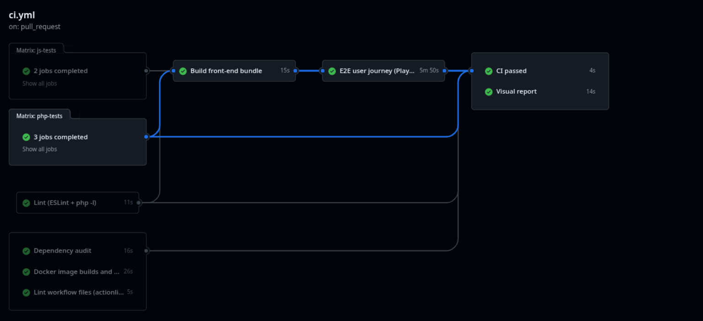

# À quoi servent les pipelines ? Démonstration en 2 parties

**Idée en une phrase :** à chaque modification, GitHub rejoue automatiquement tous les tests. Si un bug s'est glissé, **la page Actions devient rouge et indique exactement quoi corriger** ; une fois corrigé, un nouveau passage la remet au vert, sans que personne n'ait à tester à la main.

| Partie | Histoire | Ce qu'il faut faire |
|---|---|---|
| **A — Incident réel** | Une erreur de lint a fait échouer la CI ; elle a été corrigée ; la CI est repassée au vert. | **Rien à casser** : les runs existent déjà (CI #7 ❌ puis CI #9 ✅). Il suffit de prendre les captures. |
| **B — Bug dans le navigateur** | Un bug que les tests unitaires ne voient pas, attrapé uniquement par le test navigateur. | Appliquer un patch sur une branche, ouvrir une PR, prendre les captures. |

> Les images de cette page sont à déposer dans [`docs/img/`](img/) **avec exactement les noms indiqués**. Elles s'affichent « cassées » tant que le fichier n'existe pas.
> Les extraits d'erreur et la capture du navigateur de la partie B viennent d'une exécution réelle.

---

## Comment ouvrir un run (à connaître pour toutes les captures)

1. Dépôt GitHub → onglet **Actions**.
2. Dans la liste, clique sur le **titre** d'une ligne (par exemple « feat(ci): authorize control char ANSI… »). Ne clique pas sur « CI #9 » en gris : le titre en gras suffit.
3. Tu arrives sur la page **Summary** du run :
   - **en haut** : le **graphe des jobs** (cases reliées par des traits) ;
   - **en descendant** : le **rapport « 🚦 Résultat du pipeline »** ;
   - **tout en bas** : la section **Artifacts**.
4. Pour les **logs d'un job** : clique sur son nom dans le graphe (ou dans la colonne de gauche), puis sur l'étape marquée ❌ pour la déplier.

> ℹ️ **CodeQL** est désactivé sur ce dépôt privé : le *code scanning* n'y est pas activé (voir le [README](../README.md)). Son job apparaît donc grisé (⊘), sans rapport avec la démo. Pour ne regarder que le pipeline principal, utilise le filtre **Workflow ▾ → CI** en haut de la liste.

---

# Partie A — L'incident réel : lint rouge, puis vert

## Les deux runs à utiliser

Dans la liste Actions, filtre **Workflow ▾ → CI** et **Branch ▾ → main**. Tu dois voir :

| Run | Titre | Résultat | Rôle dans la démo |
|---|---|---|---|
| **CI #9** | feat(ci): authorize control char ANSI in the report | ✅ | « Après » : tout est vert |
| **CI #7** | feat(visual): add a way to see the progress of tests | ❌ | « Avant » : le lint a échoué |

*(D'après l'erreur que tu m'as envoyée, CI #7 a échoué sur le job **Lint** : règle `no-control-regex`, fichier `scripts/ci-summary.mjs` ligne 42. Vérifie-le en ouvrant le run ; si c'est un autre job, adapte simplement les légendes.)*

## Captures à prendre

### ✅ A1 — `01-vert-graphe.png` *(déjà faite)*
- **Run :** CI #9 → page Summary → graphe en haut.
- **Doit montrer :** tous les jobs en ✅, y compris Build, E2E et Visual report.


### ✅ A2 — `02-vert-rapport.png` *(déjà faite)*
- **Run :** CI #9 → Summary → rapport « 🚦 Résultat du pipeline ».
- **Doit montrer :** « Tout est vert », le schéma coloré avec 38/38, 19/19 et 3/3.



### ✅ A3 — `03-rouge-graphe.png` *(déjà faite)*
- **Run :** **CI #7** → page Summary → graphe en haut.
- **Doit montrer :** le job **Lint (ESLint + php -l)** en ❌ ; **Build front-end bundle** et **E2E user journey** grisés (⊘, « 0s ») ; **CI passed** en ❌.
- **Ce que ça démontre :** une seule erreur arrête la suite. Rien n'est livré tant que ce n'est pas réglé.



### ✅ A4 — `04-rouge-rapport.png` *(déjà faite)*
- **Run :** **CI #7** → Summary → descends jusqu'à « 🚦 Résultat du pipeline ».
- **Doit montrer :** la ligne « ❌ **1 étape(s) en échec** : Lint » et le schéma avec la case **Lint en rouge**.
- **Ce que ça démontre :** sans ouvrir un seul log, on sait déjà **quelle étape** est en cause.



### ✅ A5 — `05-rouge-logs.png` *(déjà faite)*
- **Run :** **CI #7** → clique sur le job **Lint (ESLint + php -l)** → déplie l'étape en rouge (**Run npm run lint**).
- **Doit montrer :** le message d'erreur complet :

```
/home/runner/work/mockup-CI-CD/mockup-CI-CD/scripts/ci-summary.mjs
  42:50  error  Unexpected control character(s) in regular expression: \x1b  no-control-regex
✖ 1 problem (1 error, 0 warnings)
```

- **Ce que ça démontre :** le message donne **le fichier, la ligne, la colonne et la règle**. On sait exactement quoi corriger.



### ✅ A6 — `06-retour-vert.png` *(déjà faite)*
- **Où :** onglet **Actions**, liste des runs, avec les filtres **Workflow ▾ → CI** et **Branch ▾ → main**.
- **Doit montrer, l'une sous l'autre, dans la même capture :** la ligne **CI #9 ✅** (« feat(ci): authorize control char ANSI… ») juste au-dessus de la ligne **CI #7 ❌** (« feat(visual): add a way to see… »).
- **Ce que ça démontre :** l'historique raconte tout seul « rouge, correction, vert », avec la durée de chaque run.


**Ce qui s'est passé entre #7 et #9 :** le correctif tient en une ligne ajoutée dans [`scripts/ci-summary.mjs`](../scripts/ci-summary.mjs) :

```diff
+// eslint-disable-next-line no-control-regex
 const stripAnsi = (s) => String(s ?? '').replace(/\u001b\[[0-9;]*m/g, '');
```

Un `git push` a suffi pour relancer **automatiquement** toute la CI, qui est repassée au vert.

---

# Partie B — Un bug que les tests unitaires ne voient pas

C'est le cas le plus parlant : lint ✅, tests JS ✅, tests PHP ✅, build ✅… et pourtant l'application est cassée. **Seul le test dans un vrai navigateur le détecte.**

## Étape 1 — Créer le bug (dans un terminal, à la racine du projet)

```bash
git checkout main && git pull
git checkout -b demo-bug
git apply docs/demo/bug-2-e2e.patch
git commit -am "perf: alléger l'import"
git push -u origin demo-bug
```

Le patch change une seule ligne de [`web/src/app.js`](../web/src/app.js) : la dernière ligne du fichier importé est oubliée.

```diff
-    const res = await api.importRows(state.pending.valid);
+    const res = await api.importRows(state.pending.valid.slice(0, -1));
```

## Étape 2 — Ouvrir une Pull Request

Sur GitHub, un bandeau jaune « **demo-bug had recent pushes — Compare & pull request** » apparaît. Clique dessus, puis **Create pull request**. Attends la fin du run (environ 4 minutes).

## Captures à prendre

### 📸 B1 — `07-e2e-graphe.png`
- **Où :** onglet **Pull requests** → ta PR → en bas, la ligne « CI / … » → **Details** (ou Actions → le run de la branche `demo-bug`) → page Summary, graphe en haut.
- **Doit montrer :** tout en ✅ **sauf** « E2E user journey (Playwright) » en ❌.
- **Ce que ça démontre :** lint, tests unitaires et build passent, mais l'application est cassée. Seul le test navigateur le voit.



> 💡 **« Pourquoi 3 échecs alors que je n'ai cassé qu'une chose ? »**
> Dans le panneau des vérifications de la PR, tu peux voir « CI / E2E user journey ❌ » et « CI / CI passed ❌ ». Ce n'est **qu'un seul vrai problème** :
> - **E2E user journey ❌** : la **cause** (le bug).
> - **CI passed ❌** : une **conséquence** : ce job-récapitulatif échoue automatiquement dès qu'un job requis échoue. Son rôle est d'offrir **une seule vérification à surveiller** ; son log liste les jobs (`OK lint`, `ECHEC e2e`…).
> - Un éventuel 3ᵉ rouge (CodeQL) n'a **aucun lien** : il vient de la configuration du dépôt, pas du code.
>
> Règle de lecture : **toujours traiter le job rouge le plus en amont** ; les autres suivent.

### 📸 B2 — `08-e2e-rapport.png`
- **Où :** même page Summary → descends jusqu'à la section « 🎭 Parcours utilisateur, étape par étape ».
- **Doit montrer :** « ✅ 1. Créer un compte » puis « ❌ **2. Importer un CSV avec erreurs : seule la ligne valide est acceptée** » avec le message d'erreur dessous.
- **Ce que ça démontre :** on sait **à quel moment du parcours** ça casse.

Exemple de ce que tu dois voir (exécution réelle) :

> ❌ **Parcours complet : inscription, imports CSV/XLSX, export, reconnexion**
> - ✅ 1. Créer un compte
> - ❌ **2. Importer un CSV avec erreurs : seule la ligne valide est acceptée**
>   - 💥 `Error: expect(locator).toHaveText(expected) failed`


### 📸 B3 — `09-e2e-commentaire-pr.png`
- **Où :** onglet **Pull requests** → ta PR → onglet **Conversation** → le commentaire du bot « 🚦 Résultat du pipeline ».
- **Doit montrer :** le verdict « ❌ 1 étape(s) en échec : Parcours E2E » directement dans la PR.
- **Ce que ça démontre :** le relecteur voit le problème **sans quitter la PR**.



### 📸 B4 — `10-artefacts.png`
- **Où :** page Summary du run → **tout en bas**, section **Artifacts**.
- **Doit montrer :** la ligne **playwright-report** (et `report-e2e`, `app-bundle`).
- **Ce que ça démontre :** les preuves (rapport HTML, traces, **vidéo du parcours**) sont conservées et téléchargeables.



*Bonus : télécharge `playwright-report`, ouvre `index.html` : tu vois le scénario rejoué. Playwright prend aussi une capture au moment de l'échec ; voici celle de ce bug (image réelle) : le fichier avait une ligne valide, mais l'écran affiche « rows must be a non-empty list » et 0 enregistrement.*


## Étape 3 — Corriger et relancer

```bash
git revert HEAD --no-edit
git push
```

Le push **relance automatiquement** tous les tests sur la même PR.

### 📸 B5 — `11-e2e-vert.png`
- **Où :** page Summary du **nouveau** run de la branche `demo-bug` (le plus récent en haut de la liste).
- **Doit montrer :** E2E en ✅ et, plus bas, le parcours avec les 7 étapes en ✅ (« 3/3 parcours »).
- **Ce que ça démontre :** corrigé, poussé, vérifié, sans test manuel.



> Le bouton **Re-run all jobs** (en haut à droite d'un run) rejoue les mêmes tests sur le **même** code. Il sert après un incident passager (réseau, GitHub). Pour un vrai bug, il faut d'abord **corriger le code puis pousser**, comme ci-dessus.

---

## Ce que la démo prouve

| Sans pipeline | Avec pipeline |
|---|---|
| Le bug est découvert par un utilisateur, ou par hasard | Il est découvert **en quelques minutes**, avant la livraison |
| « Ça marche chez moi » | Les tests tournent dans un environnement **neutre, identique à chaque fois** |
| Il faut tester à la main tout le parcours | Le parcours complet est rejoué **automatiquement**, navigateur compris |
| On cherche où est le problème | Le rapport indique **l'étape, le fichier, la ligne et le message** |
| Corriger puis espérer | On corrige, on pousse, on **voit** le retour au vert |

Les deux parties sont complémentaires : le **lint et les tests unitaires** sont rapides et précis (quelle ligne, quelle fonction) ; le **test navigateur** attrape ce qu'ils ne voient pas, ici un bug d'assemblage entre l'écran et le serveur.

## Remettre le dépôt à zéro (après la partie B)

```bash
git checkout main
git branch -D demo-bug
git push origin --delete demo-bug
```

## Remarque sur ce dépôt (privé)

Sur un dépôt privé en plan gratuit, GitHub n'empêche pas de fusionner une Pull Request rouge : le pipeline **informe** mais ne **bloque** pas. La démonstration reste identique ; seule la règle « interdit de fusionner si rouge » dépend du plan (voir le [README](../README.md#limites-dun-dépôt-privé-en-plan-gratuit-cas-de-ce-dépôt)).

---

## Récapitulatif : les 11 captures

| N° | Fichier | Run / page | Ce qui doit être visible | État |
|---|---|---|---|---|
| A1 | `01-vert-graphe.png` | CI #9 → Summary, haut | Tous les jobs ✅ | ✅ fait |
| A2 | `02-vert-rapport.png` | CI #9 → Summary, rapport | « Tout est vert », 38/19/3 | ✅ fait |
| A3 | `03-rouge-graphe.png` | **CI #7** → Summary, haut | Lint ❌, Build/E2E grisés | ✅ fait |
| A4 | `04-rouge-rapport.png` | **CI #7** → Summary, rapport | « 1 étape(s) en échec : Lint » | ✅ fait |
| A5 | `05-rouge-logs.png` | **CI #7** → job Lint → étape rouge | `no-control-regex`, fichier:ligne | ✅ fait |
| A6 | `06-retour-vert.png` | Actions, filtres CI + main | CI #9 ✅ au-dessus de CI #7 ❌ | ✅ fait |
| B1 | `07-e2e-graphe.png` | Run `demo-bug` → Summary, haut | Seul E2E ❌ | après étape 2 |
| B2 | `08-e2e-rapport.png` | Run `demo-bug` → rapport | Étape 2 du parcours ❌ | après étape 2 |
| B3 | `09-e2e-commentaire-pr.png` | PR → Conversation | Commentaire « 🚦 » rouge | après étape 2 |
| B4 | `10-artefacts.png` | Run → bas de page | Artefact `playwright-report` | après étape 2 |
| B5 | `11-e2e-vert.png` | Nouveau run après correction | E2E ✅, 3/3 parcours | après étape 3 |
